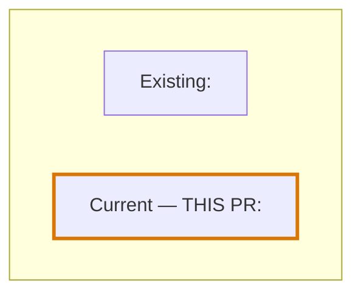

<!--
Adapt this scaffold to the repository's existing closeout or PR-description format.
It is an output template, not a required artifact or new delivery stage.
Omit sections that are not applicable and replace every placeholder with evidence.
-->

# <Project> — Pre-PR Brief

> **Canonical overview:** [<path and section>](<repository link>)  
> Reuse this overview for project context; this brief records only the current
> candidate's chapter and its relationship to the project.

## Candidate and delivery

| Field | Value |
|---|---|
| Candidate / branch / ref | `<exact candidate>` |
| Scoped paths | `<task-owned paths>` |
| Sync-work delivery status | `<actual delivery_status>` |
| PR | `<actual URL and number, or not created>` |

## Source map

Map material claims to exact sources. Use `documented` for stated intent,
`implemented` for inspected logic, and `observed` for actual execution with matching
scope. Reading a document does not make its described behavior observed.

| Claim | Source path | Section / symbol | Revision / snapshot | Kind | Status / notes |
|---|---|---|---|---|---|
| <claim> | `<path>` | `<section or symbol>` | `<resolved commit or file hash>` | documented / implemented / observed | <current, stale, conflict, unknown> |

## Project context

**Purpose and users:** <grounded sentence>.  
**Capabilities and boundaries:** <brief supported map>.  
**Verified current state:** <observed code/test behavior, with source links>.  
**Documented direction:** <existing roadmap/plan direction; no invented dates>.

Unknowns or source conflicts: <state them, including inaccessible or stale sources>.

## Conditional source-conflict issue

<!-- Include only for a confirmed material conflict; use existing tracker conventions. -->

Draft shape: [source-conflict-issue-template.md](source-conflict-issue-template.md).

| Field | Value |
|---|---|
| Sources + revisions/hashes | `<both paths, sections/symbols, resolved refs or hashes>` |
| Exact claims / kind | `<claim A vs claim B; intended contract vs observed behavior>` |
| User impact | `<material consequence>` |
| Correction or decision | `<evidence-settled patch/wording, or labeled alternatives>` |
| Acceptance / affected check | `<criterion and check>` |
| Scope / disposition | `<authorized scope; draft, existing issue, or decision needed>` |
| Tracker | `<existing issue or actual URL after event; never invent>` |

## Chapter — <meaningful candidate name>

**Project context:** <one sentence that remains meaningful if the overview link is
changed or unavailable>.

**Why it matters:** <value or capability affected>.

**Scoped before → after:** <actual behavior or value in this candidate>.

**Evidence:**

- Verification: `<command or existing report>` — <scope and fresh result>.
- Security: `<separate evidence>` — <scope and fresh result>.
- Before/after: <observed comparison or labeled proxy; no fabricated baseline>.

**Limitations and deferred work:** <risks, missing evidence, unresolved tradeoffs>.

## Whole-project roadmap

<!-- Use only supported dependencies. Omit unrelated states or nodes. Highlight this PR. -->

If Mermaid is unavailable, use the same applicable statuses as text. Do not force
sequential numbering or dependencies that the source map cannot support. Add a
future/deferred node only for distinct documented work; the current PR's capability
is not automatically a second future milestone.

## Understanding test (when the overview-and-test offer is accepted)

<!-- Adapt to the actual project and candidate. Hide answers until submission. -->

| Concept | Scenario / question | Source-backed answer or rubric | Explanation / revisit source |
|---|---|---|---|
| <meaningful project/change/evidence concept> | <concrete decision with answer controls, or a chat question> | <reviewer-only until submitted> | <why + source section> |

Show incomplete vs submitted state, actual score, feedback on each concept and a
retry path. Keep first-attempt results separate from retries after explanations.
Do not fabricate a result, preselect answers, or treat a score as delivery approval.
For a web view, verify that answer/submit/feedback/retry actually work.

## Discussion questions (summary-only request)

1. <Question about the actual project effect or evidence limit?>
2. <Question about a concrete tradeoff or next choice?>
3. <Question about an unclear requirement, if needed?>

Questions invite correction and do not count as release approval.

## Preview metadata (include only when explicitly requested)

| Field | Value |
|---|---|
| Preview identity | `<branch / candidate revision / ephemeral ID>` |
| Build/output identity | `<actual build or output hash; not just a moving alias>` |
| Stable accepted view | `<actual deployed revision + URL, or N/A>` |
| Audience | `<explicit user-selected scope>` |
| Access controls | `<auth, collaborator allowlist, or confirmed private boundary>` |
| Host and build | `<existing host/build or local-only>` |
| Timing and route | `<local before push / authorized CLI upload / authorized Git preview after push>` |
| Publication authorization | `<separate authorization/status; Git push auth is insufficient>` |
| Publication status | `local` / `pending` / `deployed` |
| Anonymous behavior | `<tested outcome for page, assets, data, aliases>` |
| Allowed / ungranted accounts | `<actual tested access outcomes, or not tested>` |

Noindex or an unguessable URL is not privacy. Protect assets, data, source maps,
alternate URLs, and deployment aliases; do not upload raw logs or auto-promote a
private preview into the public overview.
