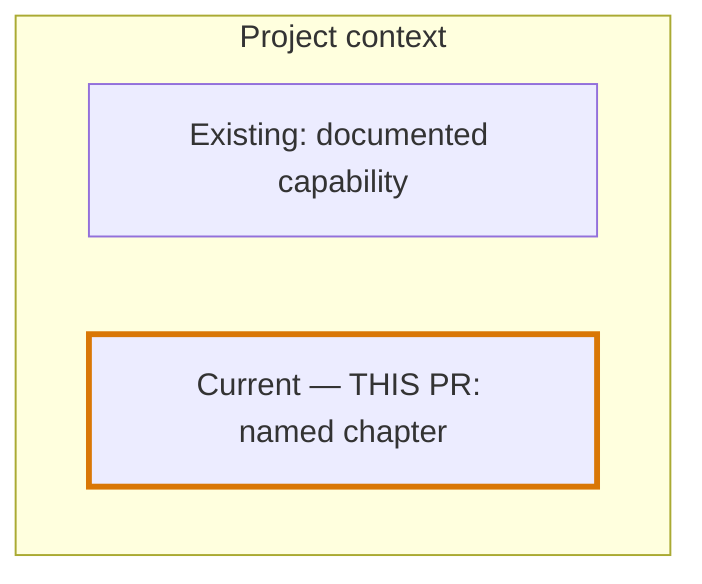

# Optional Pre-PR Brief

Before the pending push/PR, `sync-work` offers the project overview and understanding
test once. Load and execute this reference after the user accepts that offer or
explicitly requests the brief/test. Honor an existing opt-in or skip for this
candidate; do not ask repeatedly. A skip or unanswered offer does not activate the
flow or delay already-authorized delivery merely for this optional step.
It adds context inside `sync-work`'s existing
delivery flow, including Scoped Save push and Finish push/PR; it does not add a
workflow stage or change the four Finish outcomes.

## Preconditions and scope

- Work from the exact candidate already selected by `sync-work`.
- Identify the current branch and candidate before an actual PR exists. Refer to
  the branch or candidate; never fabricate a PR number or URL.
- For a local draft, inspect and label available evidence even when exact-candidate
  verification or separate security evidence is missing or stale; readiness is
  unknown. Do not add tests or re-audit merely to write the draft.
- Before any dependent push/PR or other delivery, confirm fresh exact-candidate
  verification and separate security evidence; a secret preflight alone is not
  overall verification.
- Reuse the existing completion report and Gate Package, which should still cover
  changes, evidence, risks, open questions, and decision options.
- Keep scoped files, unrelated changes, delivery state, and approval state visible;
  local verified work is not merged or released.

Without opt-in, continue the normal flow. This brief is model-neutral,
opt-in, and subordinate to existing delivery and approval boundaries.

When grounding the overview or considering an online preview, read
[grounded-overview.md](grounded-overview.md). Use the adaptable
[project-brief-template.md](../assets/project-brief-template.md) only when useful.
Maintainers testing this flow may read [pre-pr-brief-evals.md](pre-pr-brief-evals.md);
do not load that evaluation aid for ordinary briefs.

## Locate the project overview

Before writing, inspect the repository's README(s), docs index, project overview or
roadmap, manifest when present, and directly relevant candidate code or documents
as needed. Read enough to locate the canonical sources; do not rediscover the whole
project for every PR.

- Prefer an adequate existing project overview and roadmap. Patch only a
  demonstrably stale or relevant gap, using the repository's documentation
  conventions.
- Treat a README or an established project roadmap as the overview when it already
  covers the project's purpose and direction. Do not create a duplicate overview.
- If no adequate home exists, create a compact evidence-backed project summary
  using the repository's conventions. Use `docs/project-overview.md` only as a
  fallback when no existing home is suitable, and link it from an existing README
  or docs index when present.
- A conditional overview creation or update is part of this opted-in brief, not an
  always-required stage, schema, report file, or capability-pack dependency.

If creating or updating the overview adds candidate paths, disclose every
documentation path. Existing delivery authorization covers the revised candidate
only where its scope includes those paths; seek input only if the actual scope is
exceeded. Do not request blanket reapproval merely because the opt-in brief added a
relevant documentation path.

The canonical overview should cover only supported facts about:

- purpose and users;
- main capabilities and architecture boundaries;
- verified current state; and
- documented direction from existing plans or roadmaps.

Keep unknowns explicit. Do not invent a comprehensive audit, future milestones,
or dependencies merely to make the overview look complete. Do not append an
ever-growing history of PRs to the overview.

## Name the current PR chapter

Give the current candidate a meaningful named chapter in the existing closeout
report or PR-description draft, and link that chapter to the canonical overview.
Do not copy the whole project into every PR or create a numbered chapter registry.
Include one short project-context sentence so the chapter remains meaningful if the
overview link changes or is unavailable.

The chapter should state, briefly:

- why this change matters to the project;
- the scoped before/after behavior or value;
- checks actually executed, with scope and fresh evidence;
- limitations, unresolved risks, and deferred work; and
- actual delivery status, including the branch/candidate when no PR exists.

Keep observations separate from expectations. If the overview or chapter edit
changes the candidate, acknowledge it and run affected documentation or link checks.
Use the scope rules above without blanket reapproval or a full-suite rerun merely
because documentation changed. Normal exact-candidate verification, security
evidence, and delivery requirements still apply.

## Whole-project roadmap

Show a compact whole-project roadmap and highlight `THIS PR` in the relevant
capability or milestone. Use only dependencies
supported by the overview, roadmap, manifest, code, or evidence. Do not force
sequential numbering, dependency arrows, or status labels onto unrelated work.

Use the applicable statuses `done`, `current`, `proposed`, and `deferred`; omit an
unused status instead of inventing work. Keep the candidate clearly named:

Add future/deferred nodes or edges only when sources establish that distinct work
or relationship. Do not turn the current PR's own proposed capability into a
second future milestone. A project container with unconnected nodes is sufficient
when no dependency is known.
If Mermaid is unavailable, render the same whole-project roadmap as short text.
Do not turn the roadmap into a new plan artifact.

## Evidence and understanding check

Summarize actual changes and value, executed checks with scope and evidence,
observed before/after results or a clearly labeled proxy, and limitations. Reuse
valid existing evidence. If evidence is stale, missing, or limited, say so plainly
and route the gap to the existing verification or security requirement. Do not
describe the candidate as ready from a predicted result, cached PASS, or missing
check.

Do not run a full test suite, model benchmark, or fresh re-audit merely to write
this brief. Follow an existing gate when its actual integration boundary is
reached, and never weaken, replace, or infer a gate.

When the user enables the overview-and-test offer or asks for a test, provide an
answerable assessment, not "do you understand?" questions. Use a small set of
concrete scenarios covering the project, this candidate's effect, and its evidence
or delivery limits. Each question needs a source-backed answer/rubric, explanation,
and a link to revisit that concept. Avoid trivia and ambiguous product decisions.

For a website, provide actual answer controls, a submit action, score, per-question
feedback and retry. In chat, collect answers before grading and explaining them.
Do not reveal solutions before submission, preselect answers, count blanks as
correct, or invent the user's result. Incomplete submissions remain incomplete;
changing an answer invalidates a displayed verdict. Distinguish first-attempt
results from retries after explanations. Report understanding only within the
tested concepts, never as proof of general mastery.

If the user explicitly wants only a summary or discussion questions, honor that
narrower scope. Discussion questions invite correction; asking alone does not
establish understanding. A score, opt-in, skip, or unanswered question does not
count as release approval, change the Gate Package, create an approval gate,
or override the four delivery options. Keep reader assessment separate from
software tests and maintainer model evals; do not launch a benchmark to quiz a reader.

Pause a dependent push/PR action only if an answer could materially change scope,
correctness, or delivery safety, or if actual authorization is missing. Optional
understanding questions do not stall a push that is already authorized. Do not
create a commit, push, merge, PR, deployment, or other delivery action as part of
writing the brief.
